<div align="center">

# Multi-Tenant RAG SaaS

**A chatbot that only answers from *your* documents.**

Organizations sign up, upload their PDFs and docs, and get an embeddable assistant
that cites its sources and refuses to guess when the answer isn't there.


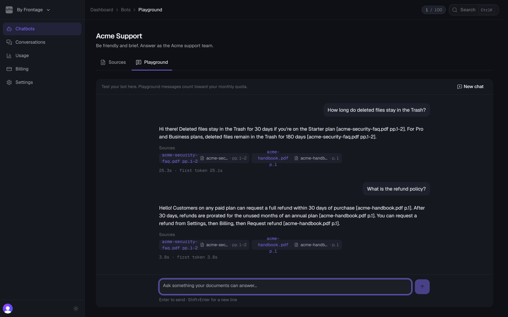

</div>

---

## Highlights

- **Hard tenant isolation.** Every vector search is filtered by `org_id` + `chatbot_id`,
  and the org is resolved server-side from the JWT or bot key, never from the request body.
  A dedicated test suite tries to read across tenants and must fail.
- **Grounded, cited answers.** Retrieve 40 candidates → rerank to the best 6 → stream the
  answer over SSE with page-level citations. If nothing relevant is found, the bot says so
  instead of hallucinating.
- **Swappable AI providers.** LLM, embedder and reranker sit behind one factory. Switching
  Gemini → Groq → Ollama (or a paid model) is an `.env` edit, not a code change, and
  Gemini automatically falls back to Groq if it fails before the first token.
- **Async ingestion.** Uploads return immediately; a Celery worker parses → chunks →
  embeds → upserts in the background (Uploading → Queued → Ready in ~4 s for a small PDF).
- **SaaS plumbing.** Per-plan limits on bots, documents and monthly messages, Redis token-bucket
  rate limiting, idempotent message metering, and Stripe billing in test mode.
- **Built on a $0 stack.** Neon, Upstash, Qdrant Cloud, Clerk and the Gemini / Groq free tiers.
  Local `bge-small` embeddings and the `bge-reranker` run on CPU.

---

## Walkthrough

### 1. Sign in

| Landing | Sign in |
|:---:|:---:|
| 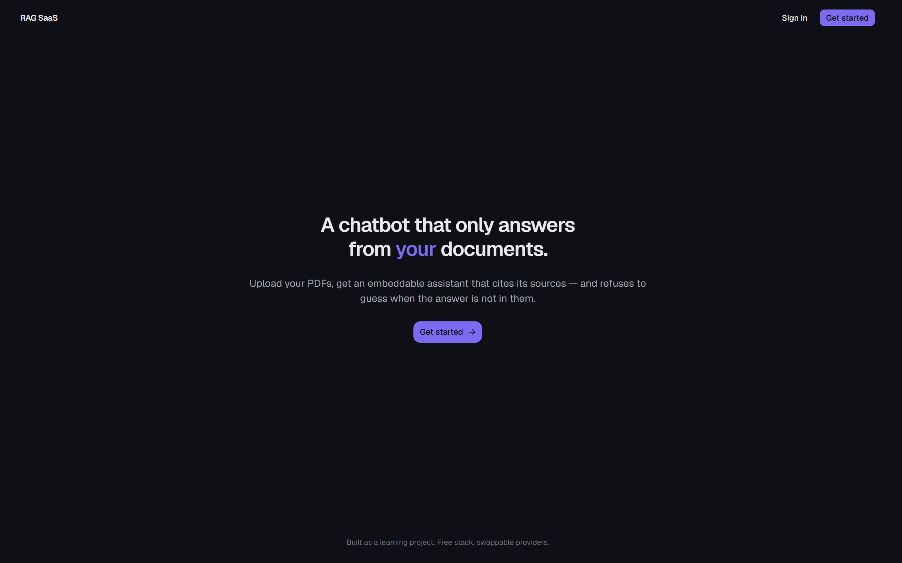 | 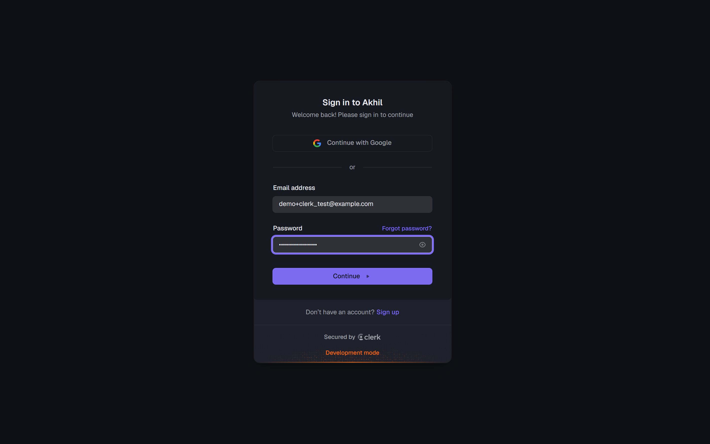 |

Authentication is handled by Clerk. The backend verifies every request's JWT (RS256, issuer
pinned) and maps it onto its own `organizations` row, so deleting an org revokes access instantly.

### 2. Create a chatbot

| Your bots | New bot |
|:---:|:---:|
| 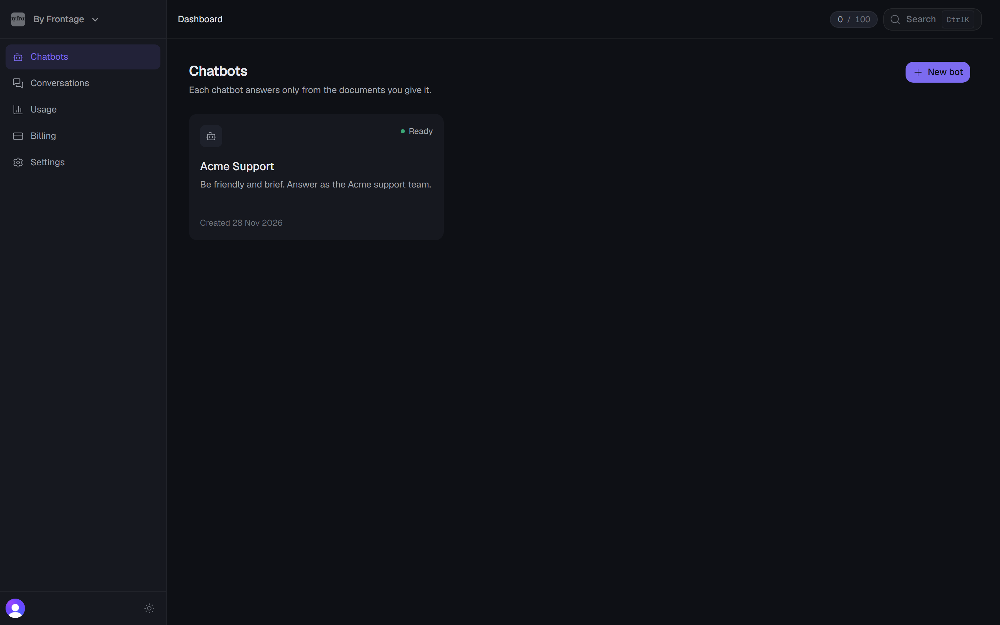 | 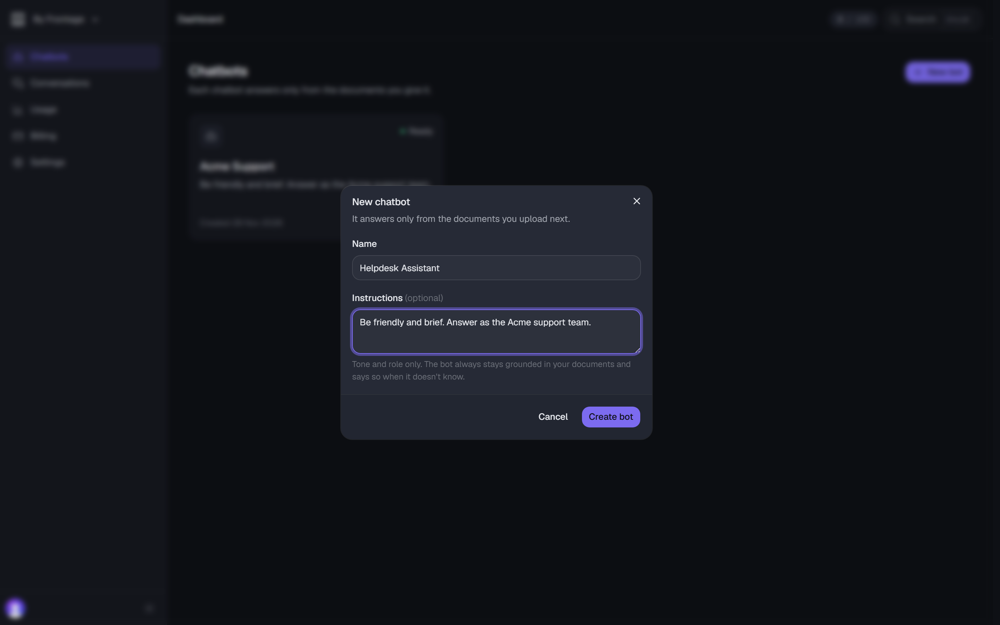 |

Each bot has its own system prompt, its own documents and a public widget key. The free plan
allows one bot; the API enforces the cap server-side, not just in the UI.

### 3. Upload documents

| Ingesting | Ready |
|:---:|:---:|
|  | 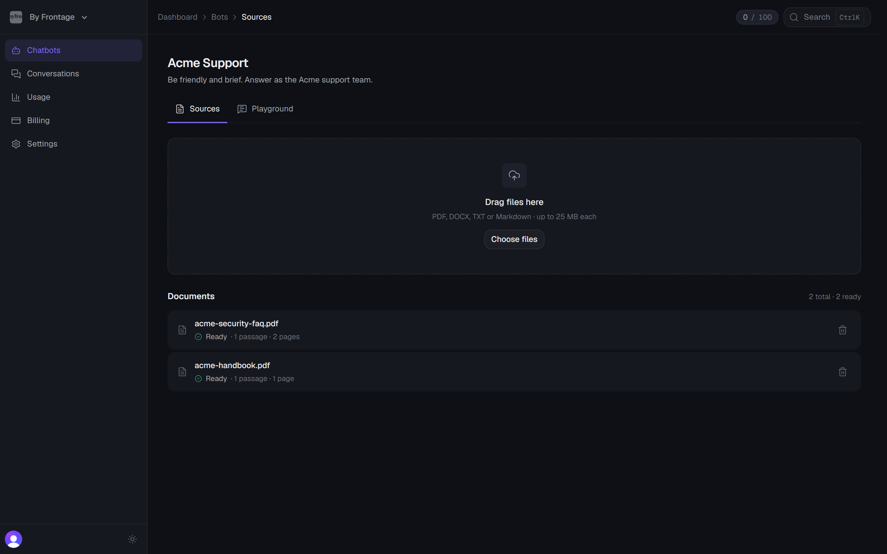 |

PDF, DOCX, TXT and Markdown, up to 25 MB. The file is size-checked while streaming,
de-duplicated by content hash, and handed to a Celery worker *after* the database commit.
The list polls until every document is `Ready` (or `Failed`, with a reason).

### 4. Chat with your documents

| Playground | Streaming |
|:---:|:---:|
| 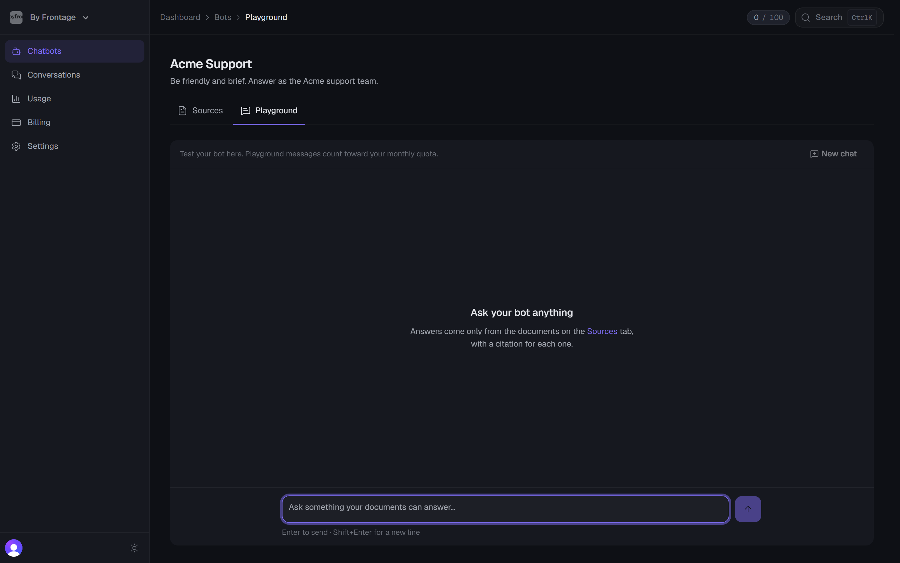 | 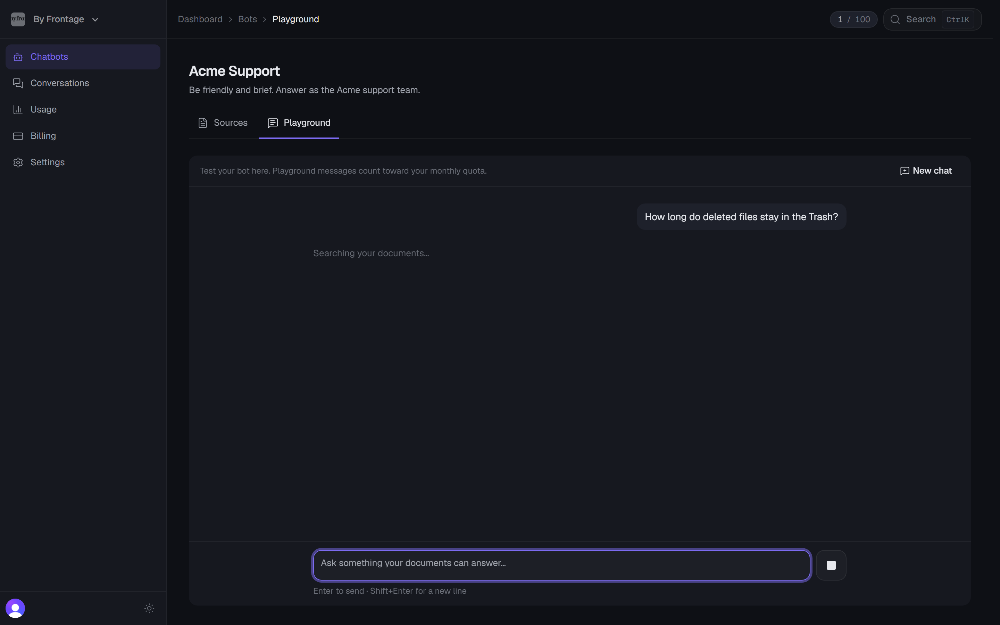 |

Answers stream token-by-token over Server-Sent Events. Each one shows its sources plus
total latency and time-to-first-token.

| Cited answers | Out-of-scope question |
|:---:|:---:|
|  | 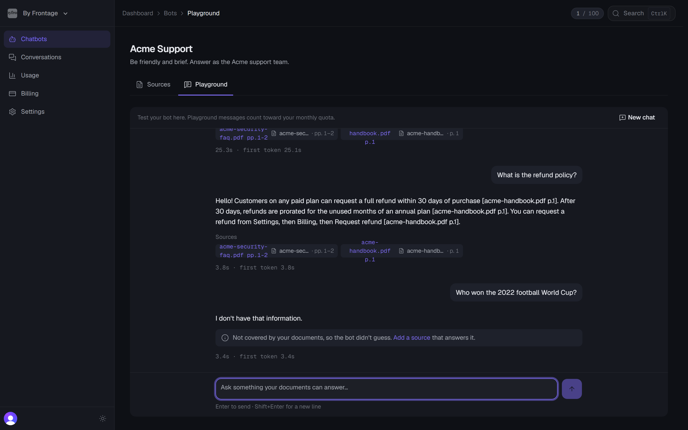 |

Ask something the documents don't cover and the bot answers *"I don't have that information"*
instead of making something up.

### 5. Billing and quick navigation

| Plans (Stripe test mode) | Command palette (`Ctrl K`) |
|:---:|:---:|
| 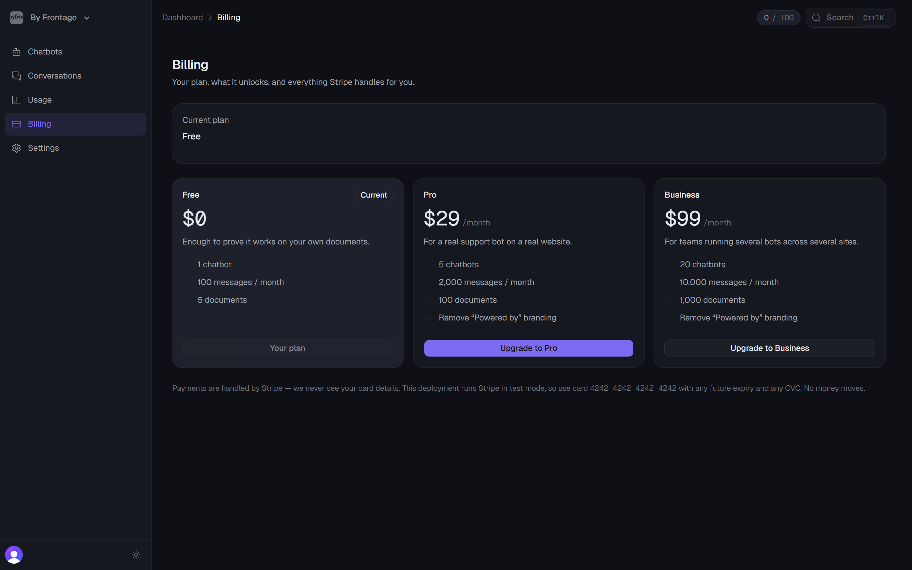 | 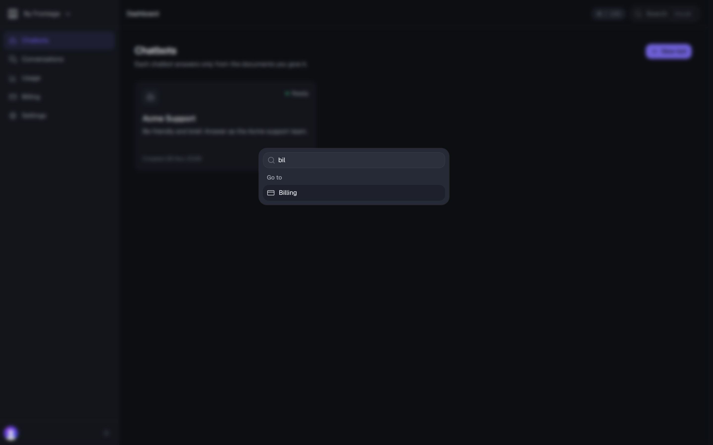 |

---

## Architecture

```
  Org admin ──► Next.js dashboard (Clerk auth)        End user ──► Embeddable widget
                        │                                              │ (public bot key)
                        └──────────────┬───────────────────────────────┘
                                       │ HTTPS · SSE for chat
                       ┌───────────────▼────────────────┐
                       │         FastAPI backend         │
                       │ verify JWT / bot key → org_id   │
                       │ retrieve → rerank → stream LLM  │
                       │ metering · plan limits · Stripe │
                       └──────┬─────────────────┬────────┘
                              │                 │ enqueue
                     ┌────────▼──────┐  ┌───────▼─────────────────┐
                     │ Postgres      │  │ Celery worker (Redis)   │
                     │ orgs, bots,   │  │ parse → chunk → embed   │
                     │ docs, usage   │  └───────┬─────────────────┘
                     └───────────────┘          │ upsert
                                        ┌───────▼─────────────────┐
                                        │ Qdrant: one collection, │
                                        │ every point tagged      │
                                        │ org_id + chatbot_id     │
                                        └─────────────────────────┘
```

**Chat path:** resolve tenant → embed question → Qdrant top-40 (mandatory tenant filter)
→ cross-encoder rerank to top-6 → grounded prompt → stream answer → log message, citations,
tokens and latency → count it against the plan.

**Provider layer** (`backend/app/providers/`), all chosen by environment variable:

| Role | Default (free) | Alternatives |
|---|---|---|
| LLM | Gemini `gemini-2.5-flash` | Groq `gpt-oss-120b` (auto-fallback), Ollama, Anthropic, OpenAI |
| Embeddings | `BAAI/bge-small-en-v1.5` (local, 384-dim) | OpenAI |
| Reranker | `BAAI/bge-reranker` (local) | Cohere, no-op (for A/B testing) |

---

## Tech stack

| Layer | Tools |
|---|---|
| Backend | FastAPI, SQLAlchemy 2, Alembic, Pydantic v2, Celery |
| Data | Postgres (Neon), Qdrant Cloud, Redis (Upstash) |
| AI | Gemini, Groq, sentence-transformers (bge embedder + reranker) |
| Frontend | Next.js 16 (App Router), React 19, Tailwind CSS v4, shadcn/ui, cmdk |
| Auth and billing | Clerk, Stripe (test mode) |
| Quality | pytest (179 tests), ruff, black, pre-commit, ESLint, TypeScript strict |

---

## Run it locally

**Prerequisites:** Python 3.11+, Node 20+, and either Docker (local Postgres, Redis and
Qdrant through `docker-compose.yml`) or free accounts on Neon, Upstash and Qdrant Cloud.
You also need Clerk keys and a Gemini or Groq API key.

```bash
# 1. Configuration: copy the templates and fill in your keys
cp .env.example .env
cp frontend/.env.local.example frontend/.env.local

# 2. Infrastructure (skip if you use the cloud services)
docker compose up -d

# 3. Backend API
cd backend
python -m venv .venv && source .venv/bin/activate   # Windows: .venv\Scripts\activate
pip install -e ".[dev]"
alembic upgrade head
uvicorn app.main:app --port 8000

# 4. Ingestion worker (second terminal, inside backend/)
celery -A app.workers.celery_app worker --loglevel=info --pool=solo

# 5. Dashboard (third terminal)
cd frontend
npm install
npm run dev            # http://localhost:3000
```

**Try it:** with a Clerk development instance you can sign in as `demo+clerk_test@example.com`
using the verification code `424242`, so no real inbox is needed.

**Swap the model:** set `LLM_PROVIDER=groq` (or `ollama`), or change `GEMINI_MODEL` / `GROQ_MODEL`
in `.env` and restart. No code changes.

**Tests:**

```bash
cd backend && pytest
```

---

## Project layout

```
backend/
  app/
    api/          FastAPI routers: bots, documents, chat, conversations, billing, widget
    core/         chunking, extraction, ingestion, retrieval, generation, metering
    providers/    LLM / embedding / rerank / billing implementations + factory
    security/     Clerk JWT verification, bot-key resolution, rate limiting
    workers/      Celery app and ingestion tasks
    widget/       embeddable loader.js + iframe chat UI
  migrations/     Alembic
  tests/          including test_isolation.py (cross-tenant leakage must be impossible)
frontend/         Next.js dashboard
docs/
  explanation/    per-phase design notes
  screenshots/    the images above
PLAN.md           full architecture and phase plan
LEARNING.md       concept notes written while building
```

---

## Roadmap

- [x] **Phase 0–1:** foundations, provider factory, core RAG pipeline
- [x] **Phase 2:** multi-tenancy, Clerk auth, CRUD API, async ingestion
- [x] **Phase 3:** streaming chat, bot-key auth, metering, plan limits
- [ ] **Phase 4:** dashboard (bots, sources and playground done; conversations, settings and usage next)
- [ ] **Phase 5:** embeddable widget
- [ ] **Phase 6:** Stripe billing (test mode)
- [ ] **Phase 7:** deployment and demo polish

---

<div align="center">
<sub>Built as a learning project: production patterns on a free stack, with every provider swappable.</sub>
</div>
